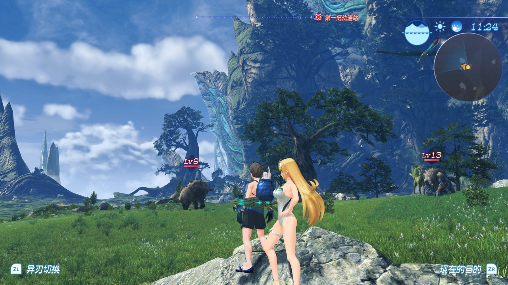

<a id="english"></a>

<div align="center">

# Xenoblade Chronicles 2 · Nintendo Switch 2 Edition

**Ahead-of-Time (Static) Recompilation for Windows x86-64 · Native Vulkan Renderer**

[](https://github.com/weile10000/xc2-ns2-recomp/releases/latest)
[](LICENSE)
[](#build-from-source)
[](docs/COMPATIBILITY.md)

**English** · [中文](#中文) · [Releases](https://github.com/weile10000/xc2-ns2-recomp/releases) · [Changelog](CHANGELOG.md) · [Compatibility](docs/COMPATIBILITY.md) · [Issues](https://github.com/weile10000/xc2-ns2-recomp/issues)

</div>

---

An ahead-of-time ("static") recompilation of the **Nintendo Switch 2 program of *Xenoblade Chronicles 2 – Nintendo Switch 2 Edition*** running natively on Windows x86-64 via Vulkan. **No emulator:** the game's original ARM64 NSO modules are lifted to C++, compiled natively, and linked against a lightweight Switch OS & NVN/NVN2 runtime layer.

> [!IMPORTANT]
> **This repository contains no game code, game assets, or cryptographic keys.**
> Release packages ship only the open-source launcher, generic runtime (`xc2_rt.dll`), and build toolchain. Game-derived builds (`xc2_boot.exe`, lifted game code) and translated shader caches (`.spv`) are never distributed — they are built locally on your own PC from your own legally acquired copy of the game.

## Target Program

| Field | Detail |
|---|---|
| **Title / Application ID** | `0100E95004038000` (update `1114112`) |
| **Recompiled Program** | **Program 1** (`0400E95004038001`) · SDK 21.4.4 ("Ounce") · NVN2 231.39 · Retail **3.0.1** |
| **Add-on Content (DLC)** | `0100E95004039001` … `0100E95004039063` (auto-discovered from your dump, non-contiguous IDs) |
| **Verified Hardware & Known Issues** | Primarily verified on **AMD RDNA 2** (RX 6800 XT · 1440p/4K: 59–60 fps typical, 43–52 fps open plains); **NVIDIA / Intel** have limited coverage and open GPU/startup issues (e.g. [#32](https://github.com/weile10000/xc2-ns2-recomp/issues/32), [#39](https://github.com/weile10000/xc2-ns2-recomp/issues/39), [#25](https://github.com/weile10000/xc2-ns2-recomp/issues/25)). See [COMPATIBILITY.md](docs/COMPATIBILITY.md), [BENCHMARK-301.md](docs/reports/BENCHMARK-301.md), and [GitHub Releases](https://github.com/weile10000/xc2-ns2-recomp/releases) |

### Screenshots (AMD RX 6800 XT · Vulkan 1.4 · Retail 3.0.1)

| Title Screen (`1920×1080` preview from `2560×1440` 60 Hz log · `TitleLogoSwap` test mod · no OSD overlay) | Gormott Field (`1280×720` preview · Clear Save · Retail `3.0.1` · no OSD overlay) |
|---|---|
|  |  |

---

## Core Capabilities

| Subsystem | Implementation |
|---|---|
| **Recompilation & Link** | `nxrecomp` lifts all 7 Switch 2 NSO modules (`main`, `sdk`, `subsdk0..3`, `rtld`) to C++ and links natively with bundled Zig/Clang or MSVC/clang-cl |
| **Graphics & Upscaling** | NVN / NVN2 → Vulkan 1.3 replay; Maxwell & Ampere SASS translated offline to SPIR-V; built-in **TAAU**, configurable render-quality & output presets (`1080p`/`1440p`/`4K`), plus optional official downloaders in the launcher for **AMD FSR 3/4** and **NVIDIA DLSS** |
| **Movies & Cutscenes** | 4K AV1 (`3840×2160`) hardware decoding via FFmpeg Vulkan Video / D3D11VA / NVDEC with `dav1d` software fallback and live cutscene hand-back |
| **Audio** | Software Opus + `nn::audio` routed to Windows XAudio2 |
| **Languages** | All 11 retail text languages selectable in the launcher (`zh-Hans`, `zh-Hant`, `ja`, `en-GB`, `fr`, `de`, `it`, `es`, `ko`, etc.); Japanese & English voices |
| **Input & UI** | Keyboard/mouse and gamepad remapping; live **F1** in-game overlay (display, upscaling, audio, pad, keybindings); launcher handles pre-boot options and one-click diagnostic reports |
| **Mod Support (WIP)** | RomFS & archive record layering scaffold under `tools/mods/` (see [docs/MODS.md](docs/MODS.md)) |

---

## Quick Start (Release Package)

The release package is self-contained — no Visual Studio, Python, .NET, or Zig installation is required.

1. **Download & Extract** the latest release archive from [GitHub Releases](https://github.com/weile10000/xc2-ns2-recomp/releases/latest) into a clean folder.
2. **Set up** — Run `xc2-launcher.exe`, select your own 3.0.1 dump (a `.nup` package or an extracted directory holding `exefs/` and `romfs/`), and click **Set up**. The launcher unpacks/links your dump, lifts and compiles `xc2_boot.exe`, translates all game shaders to SPIR-V, and runs a short headless prefill pass.
3. **Play** — Click **Play**. On the very first boot per GPU driver, Vulkan compiles its pipeline cache briefly before entering the title screen.

<details>
<summary><strong>What you must supply, save locations, in-game hotkeys &amp; bug reports</strong></summary>

| What | Where / Notes |
|---|---|
| **3.0.1 Game Dump** (`.nup` or `exefs/` + `romfs/`) | Selected in Launcher → **Set up** (add-on content under `<id>/romfs` or `<id>/0/romfs` is picked up automatically) |
| **Upscaler DLLs** *(optional)* | TAAU works out of the box; for FSR 3/4 or DLSS, use **Launcher → Settings → Upscaler** to fetch official NVIDIA Streamline / AMD FidelityFX packages into `upscalers/` |
| **Saves & Config** | Saved next to the launcher in `save/`, `nxrt.ini` (runtime), and `controls.ini` (in-game F1 overlay settings) |

* **In-game hotkeys**: `F1` — Settings overlay · `F10` — FPS counter · `F11` / `Alt+Enter` — Fullscreen toggle
* **Reporting a bug**: Always check you are on the [latest release](https://github.com/weile10000/xc2-ns2-recomp/releases/latest) first, then use **Launcher → Play → Record a report** (or **About → Record a report**) to capture `work\reports\report-<stamp>.zip` (contains logs, settings, and GPU capabilities — no game data) and attach it to a [GitHub Issue](https://github.com/weile10000/xc2-ns2-recomp/issues).

</details>

---

## Architecture

```
ExeFS (NSO) ──nxrecomp lift──▶ C++ ──Zig / clang-cl──▶ module libs ──┐
                                                                     ├──▶ xc2_boot.exe + xc2_rt.dll
Runtime (fefw-recomp: NVN/NVN2, hid, fs, audio, kernel, F1 UI) ──────┘
        │
        └──▶ Vulkan 1.3 Replay ──▶ SPIR-V Cache (offline harness + Ryujinx translator)
```

The underlying Switch/NVN layer lives in `third_party/fefw-recomp/`, while everything specific to *Xenoblade Chronicles 2 (3.0.1)* — lift sites, boot glue, audio/Opus shims, movie handling, launcher, and shader/mod tooling — lives in this repository.

## Build from Source

Requirements: **Native Windows 11 x64** *(primary target covered by release testing; Windows 10 x64 and Linux / SteamOS / Proton / Wine receive best-effort compatibility without guaranteed full regression support — community PRs and forks are welcome)*, **Vulkan 1.3 GPU**, **16 GB+ RAM**, **~60 GB free disk** (for source checkout + lifted C++ + objects), and the dev toolchain (VS Build Tools, LLVM/`clang-cl`, CMake + Ninja, .NET 10 SDK, Vulkan SDK, Python 3.12+, PowerShell 7). Full steps: [docs/BUILD.md](docs/BUILD.md) & [docs/ENVIRONMENT.md](docs/ENVIRONMENT.md).

```powershell
# Place your 3.0.1 ExeFS modules in xc2\game\xc2ns301\
.\tools\build\build.ps1 -Exefs xc2\game\xc2ns301 -Run:$false `
    -Modules 'main,sdk,subsdk0,subsdk1,subsdk2,subsdk3,rtld' `
    -LiftDir xc2\build\301\lift -ObjDir xc2\build\301\obj -LibDir xc2\build\301\lib
.\tools\build\build-boot.ps1 -Exefs xc2\game\xc2ns301 -OutDir xc2\build\301\boot `
    -LibDir xc2\build\301\lib -MainLib xc2\build\301\lib\main.lib -Defines XC2_MODULES_7
```

---

## Repository Layout

| Path | Description |
|---|---|
| [`xc2/`](xc2/README.md) | Game-specific code: hook/site tables (`sites/`), boot glue (`src/`), module config (`recomp/`), split-DLL build (`release/`), smoke tests (`tests/`) |
| [`launcher/`](launcher/README.md) | Windows Tauri + JS launcher (`.nup` unpacker, setup runner, settings UI, official DLSS/FSR downloaders, report capture) |
| [`third_party/fefw-recomp/`](third_party/fefw-recomp/MODIFICATIONS.md) | Switch OS & NVN → Vulkan runtime fork (with patch log in `MODIFICATIONS.md`) |
| [`tools/`](tools/README.md) | Developer & setup tooling (`setup/`, `shader/`, `build/`, `run/`, `analysis/`, `ci/`, `mods/`) |
| [`config/`](config/) | Runtime configuration schema (`keys.tsv`), install ini template (`nxrt.ini.in`), and dev run profiles |
| [`docs/`](docs/) | Public guides, architecture specs, reports, and archived release notes |
| [`licenses/`](licenses/) & [`THIRD_PARTY_NOTICES.md`](THIRD_PARTY_NOTICES.md) | Bundled third-party dependency licences |
| [`.github/`](.github/) | CI workflows (`tools/ci/*.py` checks) and issue templates |

## Documentation

| Category | Documents |
|---|---|
| **Getting Started** | [QUICKSTART.md](docs/QUICKSTART.md) · [COMPATIBILITY.md](docs/COMPATIBILITY.md) · [TROUBLESHOOTING.md](docs/TROUBLESHOOTING.md) · [SETTINGS.md](docs/SETTINGS.md) |
| **Building & Internals** | [BUILD.md](docs/BUILD.md) · [ENVIRONMENT.md](docs/ENVIRONMENT.md) · [ARCHITECTURE.md](docs/ARCHITECTURE.md) · [MEDIA.md](docs/MEDIA.md) · [MODS.md](docs/MODS.md) |
| **Governance & History** | [INVARIANTS.md](docs/INVARIANTS.md) · [CONTRIBUTING.md](CONTRIBUTING.md) · [CHANGELOG.md](CHANGELOG.md) · [STATUS.md](STATUS.md) · [SECURITY.md](SECURITY.md) |

---

## Credits & Legal Notice

* **[nxrecomp](https://github.com/drakolordx7/nxrecomp)** — Static ARM64 → C++ recompiler
* `Goldoire/fefw-recomp` *(upstream GitHub repo removed / 404)* — Base Switch runtime, NVN/NVN2 Vulkan replay, and shader pipeline (self-contained vendored fork preserved at [`third_party/fefw-recomp/`](third_party/fefw-recomp/MODIFICATIONS.md))
* **Ryujinx** (MIT) — Maxwell shader translator behind `spirv_harness`
* **[@capibawa](https://github.com/capibawa)** — [`nxnative` (`xc2-ns2-profile`)](https://github.com/capibawa/nxnative/tree/xc2-ns2-profile) launch switches & host media patterns
* **[AksharDP/xc2-recomp](https://github.com/AksharDP/xc2-recomp)** & **[Lichii](https://github.com/zortos293/Lichii)** — Address & reference findings
* **Community Contributors** — Credited individually in each [GitHub Release](https://github.com/weile10000/xc2-ns2-recomp/releases)
* **Vendored Libraries & AI-Assisted Development** — SDL3, Vulkan-Headers, VMA, Dav1d, FFmpeg, Dear ImGui ([THIRD_PARTY_NOTICES.md](THIRD_PARTY_NOTICES.md)). Architecture, on-hardware testing, and final code review/merging are led by the human maintainer, with AI assistance:
  * Paired with **DeepSeek** ([deepseek.md](deepseek.md))
  * **Gemini 4** ([gemini.md](gemini.md)) — assisting maintenance starting from v0.2.1

**Licence:** Project code is licensed under **GPL-3.0-or-later** ([LICENSE](LICENSE)). Third-party dependencies retain their respective licences. **No licence here grants any rights to Nintendo's copyrighted game code or assets; lifted user binaries remain the property of their respective rights holders.**

**Legal Notice:** Independent, non-commercial fan project. Not affiliated with, sponsored by, or endorsed by Nintendo or MONOLITH SOFT. *Xenoblade Chronicles*, *Xenoblade Chronicles 2*, *Nintendo Switch*, and *Nintendo Switch 2* are trademarks of Nintendo.

---

<a id="中文"></a>

<div align="center">

# 异度之刃 2 · Nintendo Switch 2 Edition

**Windows x86-64 提前（静态）重编译 · 原生 Vulkan 渲染**

[](https://github.com/weile10000/xc2-ns2-recomp/releases/latest)
[](LICENSE)
[](#从源码构建)
[](docs/COMPATIBILITY.md)

[English](#english) · **中文** · [发布页面 (Releases)](https://github.com/weile10000/xc2-ns2-recomp/releases) · [更新日志](CHANGELOG.md) · [兼容性说明](docs/COMPATIBILITY.md) · [问题反馈 (Issues)](https://github.com/weile10000/xc2-ns2-recomp/issues)

</div>

---

将《异度之刃 2 – Nintendo Switch 2 Edition》的 **Switch 2 主程序**做提前（静态）重编译，在 Windows x86-64 上通过原生 Vulkan 直接运行。**非模拟器实现：** 游戏原始的 ARM64 NSO 模块会被举升为 C++、本地原生编译，并与轻量化 Switch 系统及 NVN/NVN2 运行时层链接运行。

> [!IMPORTANT]
> **本仓库不包含任何游戏本体代码、美术资源或解密密钥。**
> 发行包仅分发开源启动器、通用运行时（`xc2_rt.dll`）与构建工具链；任何包含举升后游戏代码的可执行程序（`xc2_boot.exe`）与着色器缓存（`.spv`）从不随包分发，必须由你在自己电脑上使用合法持有的游戏副本现场构建。

## 目标程序信息

| 项目 | 说明 |
|---|---|
| **Title / Application ID** | `0100E95004038000`（Update `1114112`） |
| **重编译程序目标** | **Program 1**（`0400E95004038001`）· SDK 21.4.4 ("Ounce") · NVN2 231.39 · 零售版 **3.0.1** |
| **附加内容（DLC）** | `0100E95004039001` … `0100E95004039063`（从同份 dump 自动识别，号段非连续） |
| **验证硬件与已知限制** | 主要在 **AMD RDNA 2**（RX 6800 XT · 1440p/4K：常规 59–60 fps、大型平原 43–52 fps）完成验证；**NVIDIA / Intel** 覆盖有限且存在已知问题（如 N 卡 [#32](https://github.com/weile10000/xc2-ns2-recomp/issues/32)、[#39](https://github.com/weile10000/xc2-ns2-recomp/issues/39)、[#25](https://github.com/weile10000/xc2-ns2-recomp/issues/25)）。详见 [COMPATIBILITY.md](docs/COMPATIBILITY.md)、[BENCHMARK-301.md](docs/reports/BENCHMARK-301.md) 与 [GitHub Releases](https://github.com/weile10000/xc2-ns2-recomp/releases) |

### 实机运行截图（AMD RX 6800 XT · Vulkan 1.4 · 零售版 3.0.1）

| 标题画面（`1920×1080` 预览图，源自 `2560×1440` 60 Hz 运行日志 · 含 `TitleLogoSwap` 归档 MOD · 无屏显帧率） | 古拉原野实机画面（`1280×720` 预览图 · 通关存档 · 零售版 `3.0.1` · 无屏显帧率） |
|---|---|
|  |  |

---

## 核心特性

| 子系统 | 实现能力 |
|---|---|
| **静态重编译与链接** | 通过 `nxrecomp` 举升全套 7 个 Switch 2 NSO 模块（`main`、`sdk`、`subsdk0..3`、`rtld`），并用自带 Zig/Clang 或 MSVC/clang-cl 链接为原生程序 |
| **图形渲染与超分** | NVN / NVN2 → Vulkan 1.3 重放；Maxwell / Ampere 着色器离线转译为 SPIR-V；内建 **TAAU**，支持多档渲染质量与输出分辨率预设（`1080p` / `1440p` / `4K`），启动器内置 **AMD FSR 3/4** 与 **NVIDIA DLSS** 官方直链可选下载 |
| **4K 影片与过场** | FFmpeg Vulkan Video / D3D11VA / NVDEC 硬件解码 4K AV1 影片（`dav1d` 软解兜底），叠加实时过场可无缝交还场景 |
| **音频** | 软件 Opus 解码 + `nn::audio` 路由至 Windows XAudio2 |
| **多语言支持** | 启动器直接切换零售 3.0.1 自带的全部 11 种文本语言（含简繁中文、日、英、法、德、意、西、韩等）；支持日/英双语语音 |
| **操作与交互** | 键鼠与手柄自定义重映射；游戏内按 **F1** 呼出实时设置浮层（显示、画质、音频、手柄、按键绑定）；启动器负责前置配置与一键诊断打包 |
| **MOD 架构（开发中）** | `tools/mods/` 已奠定 RomFS 与归档记录覆盖基础能力（设计规范见 [docs/MODS.md](docs/MODS.md)） |

---

## 快速开始（发行版便携包）

发行版压缩包为完全自包含环境——**无需预先安装 MSVC、Python、.NET 或 Zig**。

1. **下载并解压**：从 [GitHub Releases](https://github.com/weile10000/xc2-ns2-recomp/releases/latest) 下载最新版发行包，解压到一个**干净的独立文件夹**。
2. **首次初始化（Set up）**：运行 `xc2-launcher.exe`，选择你自己合法提取的 3.0.1 游戏副本（`.nup` 整包，或已解包的 `exefs/` + `romfs/` 目录），点击 **Set up**。工具会自动完成文件挂载、C++ 代码举升与原生编译、全量着色器 SPIR-V 翻译以及首帧无头预热。
3. **开始游玩（Play）**：初始化完成后点击 **Play**。更换显卡驱动后的首次启动会短暂编译一次 GPU 管线，随后即可进入标题画面。

<details>
<summary><strong>自备清单、存档位置、游戏内快捷键与反馈报告方法（点击展开）</strong></summary>

| 需要准备 | 说明 |
|---|---|
| **3.0.1 游戏副本**（`.nup` 或 `exefs/` + `romfs/`） | 在启动器 **Set up** 指定；符合 `<id>/romfs` 或 `<id>/0/romfs` 结构的 DLC 会自动挂载 |
| **超分厂商 DLL** *(可选)* | 内建 TAAU 开箱即用；如需 FSR 3/4 或 DLSS，可在 **启动器 → 设置 → 超分** 勾选许可后一键从 NVIDIA / AMD 官方渠道下载至 `upscalers/` |
| **存档与配置位置** | 均保存在启动器同级的 `save/`、`nxrt.ini`（运行时配置）与 `controls.ini`（游戏内 F1 设置与键位）中 |

* **游戏内快捷键**：`F1` —— 打开设置浮层 · `F10` —— 帧率监控 · `F11` / `Alt+Enter` —— 切换全屏
* **反馈问题**：请先确认使用的是 [最新发行版](https://github.com/weile10000/xc2-ns2-recomp/releases/latest)，然后通过 **启动器 → Play → 录一份报告**（或 **About → 录一份报告**）复现后关闭窗口，把生成的 `work\reports\report-<时间戳>.zip` 附到 [GitHub Issues](https://github.com/weile10000/xc2-ns2-recomp/issues)（内含日志、配置与显卡参数，不含任何游戏文件）。

</details>

---

## 工作原理

```
ExeFS (NSO) ──nxrecomp 举升──▶ C++ ──Zig / clang-cl──▶ 模块静态库 ──┐
                                                                      ├──▶ xc2_boot.exe + xc2_rt.dll
运行时层（fefw-recomp：NVN/NVN2、hid、fs、audio、kernel、F1 菜单）─────┘
        │
        └──▶ Vulkan 1.3 重放 ──▶ SPIR-V 缓存（离线 harness + Ryujinx 翻译器）
```

通用 Switch 系统服务与 NVN 重放层位于 `third_party/fefw-recomp/`；所有与《异度之刃 2（3.0.1）》强绑定的部分（举升点表、启动胶水、音频/Opus 垫片、影片接管、启动器与着色器/MOD 工具）均在本仓库维护。

## 从源码构建

环境要求：**原生 Windows 11 x64**（主要测试与官方支持目标；Windows 10 x64 与 Linux / SteamOS (Proton / Wine) 仅提供尽力适配，暂不保证完整回归测试，欢迎社区 PR 或 Fork）、**支持 Vulkan 1.3 的显卡**、**16 GB+ 内存**、**约 60 GB 可用磁盘空间**，以及全套构建工具链（VS Build Tools、LLVM/`clang-cl`、CMake + Ninja、.NET 10 SDK、Vulkan SDK、Python 3.12+、PowerShell 7）。完整步骤请查阅 [docs/BUILD.md](docs/BUILD.md) 与 [docs/ENVIRONMENT.md](docs/ENVIRONMENT.md)。

```powershell
# 先将 3.0.1 的 ExeFS 模块放入 xc2\game\xc2ns301\
.\tools\build\build.ps1 -Exefs xc2\game\xc2ns301 -Run:$false `
    -Modules 'main,sdk,subsdk0,subsdk1,subsdk2,subsdk3,rtld' `
    -LiftDir xc2\build\301\lift -ObjDir xc2\build\301\obj -LibDir xc2\build\301\lib
.\tools\build\build-boot.ps1 -Exefs xc2\game\xc2ns301 -OutDir xc2\build\301\boot `
    -LibDir xc2\build\301\lib -MainLib xc2\build\301\lib\main.lib -Defines XC2_MODULES_7
```

---

## 仓库目录结构

| 路径 | 说明 |
|---|---|
| [`xc2/`](xc2/README.md) | 游戏专属实现：举升位点表（`sites/`）、启动胶水（`src/`）、模块配置（`recomp/`）、分离式 DLL 构建（`release/`）、冒烟测试（`tests/`） |
| [`launcher/`](launcher/README.md) | Windows Tauri + JS 启动器（`.nup` 解包、Set up 调度、可视化配置、官方 DLSS/FSR 下载与报告录制） |
| [`third_party/fefw-recomp/`](third_party/fefw-recomp/MODIFICATIONS.md) | Switch OS 与 NVN → Vulkan 运行时分支（全部改动记录于 `MODIFICATIONS.md`） |
| [`tools/`](tools/README.md) | 构建、运行、安装与分析脚本（`setup/`、`shader/`、`build/`、`run/`、`analysis/`、`ci/`、`mods/`） |
| [`config/`](config/) | 配置键名 Schema（`keys.tsv`）、安装 ini 模板（`nxrt.ini.in`）与开发运行配置 |
| [`docs/`](docs/) | 公开文档、架构说明、分析报告与各版本历史发布公告 |
| [`licenses/`](licenses/) 与 [`THIRD_PARTY_NOTICES.md`](THIRD_PARTY_NOTICES.md) | 随包分发组件的第三方开源许可文本 |
| [`.github/`](.github/) | CI 检查工作流（`tools/ci/*.py`）与 Issue 模板 |

## 文档导航

| 分类 | 文档列表 |
|---|---|
| **使用与排查** | [QUICKSTART.md](docs/QUICKSTART.md) · [COMPATIBILITY.md](docs/COMPATIBILITY.md) · [TROUBLESHOOTING.md](docs/TROUBLESHOOTING.md) · [SETTINGS.md](docs/SETTINGS.md) |
| **构建与架构** | [BUILD.md](docs/BUILD.md) · [ENVIRONMENT.md](docs/ENVIRONMENT.md) · [ARCHITECTURE.md](docs/ARCHITECTURE.md) · [MEDIA.md](docs/MEDIA.md) · [MODS.md](docs/MODS.md) |
| **规范与里程碑** | [INVARIANTS.md](docs/INVARIANTS.md) · [CONTRIBUTING.md](CONTRIBUTING.md) · [CHANGELOG.md](CHANGELOG.md) · [STATUS.md](STATUS.md) · [SECURITY.md](SECURITY.md) |

---

## 致谢与法律声明

* **[nxrecomp](https://github.com/drakolordx7/nxrecomp)** —— 静态 ARM64 → C++ 重编译器
* `Goldoire/fefw-recomp` *（原 GitHub 仓库已下架 / 404）* —— Switch 基础运行时、NVN/NVN2 Vulkan 重放与着色器管线底座（完整独立分支留存于 [`third_party/fefw-recomp/`](third_party/fefw-recomp/MODIFICATIONS.md)）
* **Ryujinx**（MIT）—— `spirv_harness` 背后的 Maxwell 着色器翻译器
* **[@capibawa](https://github.com/capibawa)** —— [`nxnative`（`xc2-ns2-profile` 分支）](https://github.com/capibawa/nxnative/tree/xc2-ns2-profile) 的启动参数与宿主媒体方案参考
* **[AksharDP/xc2-recomp](https://github.com/AksharDP/xc2-recomp)** 与 **[Lichii](https://github.com/zortos293/Lichii)** —— 相关地址与结构参考
* **社区贡献者** —— 每位 PR 贡献者均会在对应版本的 [GitHub Releases](https://github.com/weile10000/xc2-ns2-recomp/releases) 中署名致谢
* **依赖与 AI 辅助研发** —— SDL3、Vulkan-Headers、VMA、dav1d、FFmpeg、Dear ImGui 等第三方库见 [THIRD_PARTY_NOTICES.md](THIRD_PARTY_NOTICES.md)。项目架构设计、实机测试与代码审查合入均由人类维护者主导把关，AI 协作如下：
  * 开发过程与 **DeepSeek** 结对协作（[deepseek.md](deepseek.md)）
  * **Gemini 4**（[gemini.md](gemini.md)）—— 自 v0.2.1 版本起辅助项目维护

**开源许可：** 本项目自有代码采用 **GPL-3.0-or-later**（[LICENSE](LICENSE)）；第三方组件保留其各自许可。**此处任何许可均不授予任天堂游戏代码或资源的任何权利；由玩家自行构建产出的举升二进制文件不属于本仓库分发内容，权利仍归原权利方所有。**

**法律声明：** 本项目为独立、非商业性的技术爱好者项目，与任天堂或 MONOLITH SOFT 没有任何关联，亦未获得其赞助或认可。*Xenoblade Chronicles*、*Xenoblade Chronicles 2*、*Nintendo Switch* 与 *Nintendo Switch 2* 均为任天堂公司的注册商标。
