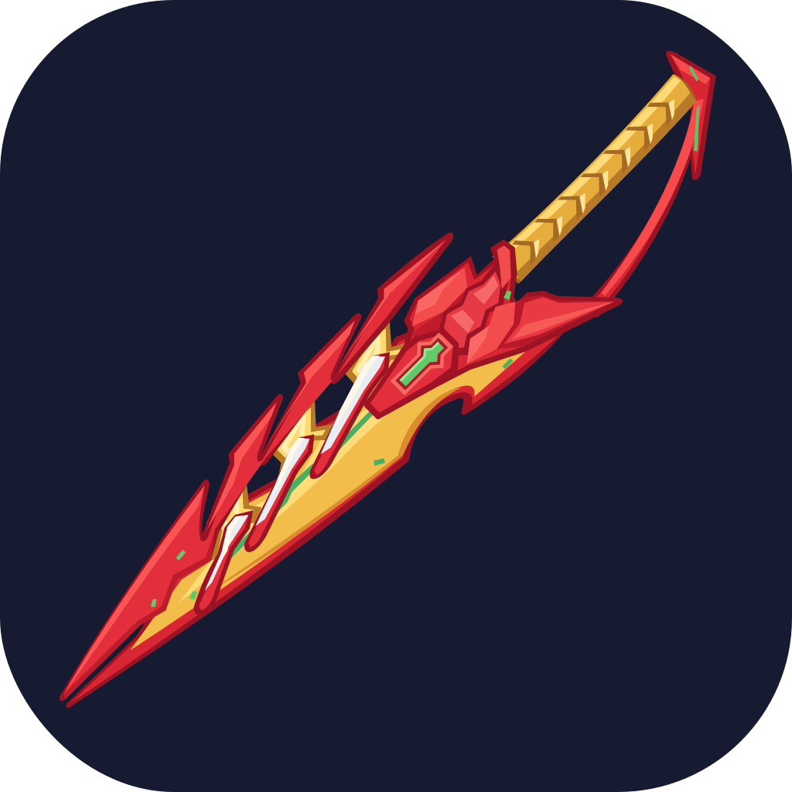

<p align="center"></p>

# xc2-ns2-recomp

A native Windows PC port of **Xenoblade Chronicles 2 – Nintendo Switch 2 Edition**, made by static recompilation:
the game's code is translated into a regular Windows program on your own PC, and runs on a small runtime that
stands in for the console's system software. The picture is drawn by **NVN-HLE**, which replays the game's graphics
calls on Vulkan. It is not an emulator.

> **No game files are included.** You need your own legally dumped copy of the game. Everything that reads the game
> happens on your PC, and nothing is written into your dump. Not affiliated with or endorsed by Nintendo or
> Monolith Soft.

## Status

STATUS_TABLE

Testing so far has been narrow, so expect rough edges (AMD and Intel GPUs are untried). See
[docs/TROUBLESHOOTING.md](docs/TROUBLESHOOTING.md), and open an issue with the log if something goes wrong.

## Play it

1. Download `xc2-ns2-recomp-<version>-windows-x64.zip` from [Releases](../../releases) and extract it into a new
   folder.
2. Run `xc2-launcher.exe`, press **Build**, pick your dump (the `.nup`, or its ExeFS and RomFS folders), keep
   **Download NVIDIA DLSS** ticked if you have an NVIDIA RTX card, and press **Build** again.
3. When it says your game is ready, press **Play**.

Nothing needs to be installed. The first build takes about 5 to 10 minutes: it downloads the compiler once (Zig,
about 100 MB, from ziglang.org) and NVIDIA Streamline if you ticked it (276 MB), then recompiles the game's code on
your PC. Later starts go straight to the game.

**What you need:** Windows 10 or 11 (x64), a graphics card with Vulkan 1.3 (NVIDIA RTX for DLSS), about 16 GB of
RAM, about 40 GB of free disk space, and your dump of XC2 Switch 2 Edition **3.0.1**. Add-ons (the Expansion Pass,
Torna – The Golden Country) are used when the dump has them; the game runs without them.

**Keys:** F1 menu · F10 performance overlay · F11 fullscreen · F12 screenshot. A gamepad works out of the box;
keyboard and mouse bindings are on the F1 menu's Controls page.

## Build from source

For developers: the same setup, with the runtime built from this checkout instead of the release's prebuilt one.

| tool | version | used for |
|---|---|---|
| Visual Studio Build Tools (MSVC + Windows SDK) | 2022+ | headers and import libraries for clang-cl |
| LLVM | 22+ | `clang-cl`, `llvm-lib` |
| CMake + Ninja | 3.25+ | the runtime |
| Python | 3.12 with `lz4`, `capstone`, `zstandard` | the recompiler and the dump reader |
| PowerShell | 7+ (`pwsh`) | the build scripts |

Put them on `PATH`, or set `XC2_ENV` to a PowerShell script that does ([docs/BUILD.md](docs/BUILD.md)). Then:

```powershell
python tools\setup\xc2_nvnhle_setup.py --repo . --install work\play --nup "D:\dumps\Xenoblade Chronicles 2.nup"
tools\run\play-xc2nh.cmd
```

The setup downloads the prebuilt NVN-HLE library from the release (set `XC2_NVNHLE_DIST` to use one you built),
builds the runtime, reads the dump, recompiles and links the game (`xc2/build/301/boot-n2den/xc2.exe`). With
folders instead of a `.nup`: `--exefs <dir> --romfs <dir> [--dlc <dir>]` (`--dlc`: a folder of add-ons, each
`<title id>/romfs`). The launcher (`launcher/`, `npm install` then `npm run tauri build -- --no-bundle`) runs the
same engine. The release package is made with `tools/build/build-release.ps1` and
`tools/build/make-package-xc2.ps1`.

| | |
|---|---|
| `xc2/` | the boot program (`xc2/src/xc2_boot.cpp`, `--nvn n2den`), hook site lists, icon and supported build |
| `third_party/fefw-recomp/` | the runtime: system services, input, audio, movies, the overlay, the NVN-HLE adapter |
| `tools/setup/xc2_nvnhle_setup.py` | the setup engine (the launcher runs it) |
| `launcher/` | the Tauri launcher |

This repository is the XC2 side of [xcde-ns2-recomp](https://github.com/Duck912/xcde-ns2-recomp) (Xenoblade
Chronicles: Definitive Edition – Switch 2 Edition): the same runtime, renderer and launcher, set up for XC2. Both
started as an import of [xc2-ns2-recomp](https://github.com/weile10000/xc2-ns2-recomp) by weile10000 with its full
history; that project draws with the runtime's own renderer, this one with NVN-HLE. Its README is kept as
[README.xc2.md](README.xc2.md).

## Credits

- **NVN-HLE**, the renderer: duck912 and the Eglantine Community, ported to n2den, and from there into
  this project. Its source for each release is attached to the release (`n2den-nvnhle-src-*.zip`).
- [xc2-ns2-recomp](https://github.com/weile10000/xc2-ns2-recomp) (weile10000 and contributors): the base this port
  is built on, including the XC2 hooks, the settings menu and the launcher.
- [fefw-recomp](https://github.com/Goldoire/fefw-recomp) and nxrecomp: the runtime and the recompiler.
- n2den and Eden, and everyone before them: Ryujinx, Sudachi, Citron, Torzu, Suyu and Ryubing.
- nxnative and everyone those projects credit; see [README.xc2.md](README.xc2.md) and
  [THIRD_PARTY_NOTICES.md](THIRD_PARTY_NOTICES.md).
- The launcher's design follows Longshot's.

License: GPL-3.0-or-later (matching the projects it builds on).
